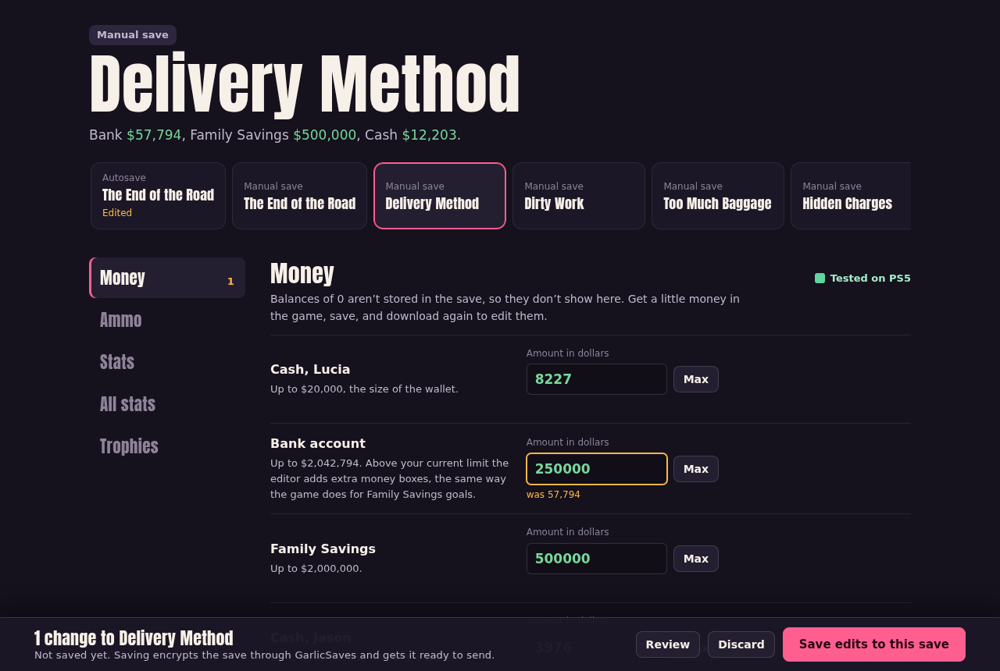
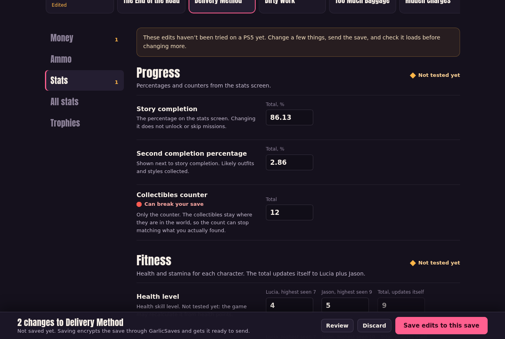
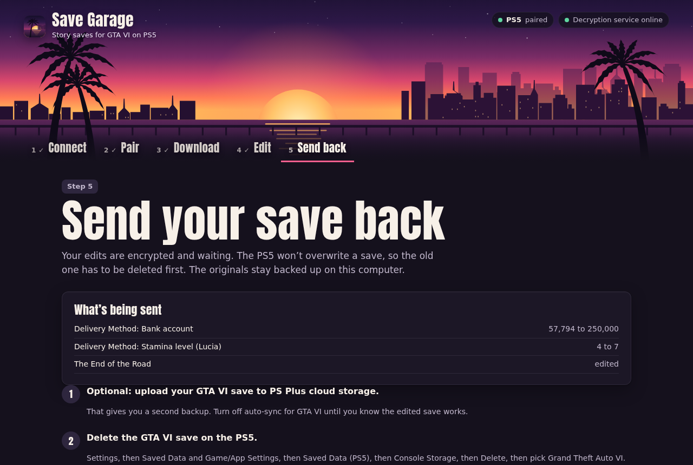

<p align="center"></p>

<p align="center">
  <a href="../../releases/latest"><b>Download the latest release</b></a>
  &nbsp;&nbsp;|&nbsp;&nbsp; Windows, macOS and Linux &nbsp;&nbsp;|&nbsp;&nbsp; Free and open source (GPL-3.0)
</p>

Save Garage edits your **GTA VI story-mode save on PS5**: money, ammo and stats. It needs no jailbreak and installs
nothing on the console. Your PS5 sends the save to your computer through its own Data Transfer feature, you edit it in
your browser, and the PS5 takes it back the same way.

<p align="center"></p>

## What you can change

| | What | Status |
|---|---|---|
| **Money** | Bank account, Family Savings and cash for Lucia and Jason. Goes past the BuckMe limits: up to about $2,000,000 in the bank and in Family Savings, $20,000 cash. | Tested on PS5 |
| **Ammo** | Every ammo type each character is carrying, with one-click fill. | Not tested on PS5 yet |
| **Stats** | 57 stats in plain English: story completion, health and stamina levels, play time, distance, money earned, wanted levels, kills, fish, rentals, gadgets and more. | Not tested on PS5 yet |
| **All stats** | Every one of the 23,760 stats in the save, searchable. Most have no known name yet. | Can break your save |
| **Trophies** | Not editable. The Trophies page in the app explains what a save edit can and can't do for them. | |

Every edit in the app carries one of those labels, so you always know how safe it is. Edits are always applied to
your original save, and the original is backed up on your computer before anything changes.

<p align="center"></p>

## Before you start

- A PS5 with GTA VI (PPSA01547 or PPSA38500). Tested on system software 14.23.
- A Windows 10 or 11 PC, a Mac, or a Linux computer on the **same home network** as the PS5.
- An internet connection: decrypting and re-encrypting the save runs on the [GarlicSaves](https://garlicsaves.com) service.

## How to use it

1. **Download and start Save Garage.** Get the zip for your system from [Releases](../../releases/latest), unzip
   it and run `SaveGarage`. Your browser opens the editor at `http://127.0.0.1:7283`.
   - Windows: allow it through the firewall on private networks when asked. The PS5 needs to reach your PC.
   - Mac: allow access to devices on your local network. If macOS won't open the app, go to
     System Settings, then Privacy & Security, and click Open Anyway.
   - Linux: see [Linux notes](#linux-notes).
2. **Connect.** Click Find my PS5, or type its IP address.
3. **Pair (once per console).** Click Start pairing, then on the PS5 go to Settings, then System, then System
   Software, then Data Transfer, and pick **Save Garage Pairing**. The PS5 says it can't transfer data. That's
   expected: pairing has already happened.
4. **Download.** In GTA VI, save your game and go back to the PS5 home screen. Click Download save. When the app
   asks, press the PS5 power button once and let go at the beep. The console restarts into transfer mode, and
   again when the download is done.
5. **Edit.** Pick a save (the autosave is what Continue loads), change what you want and click Save edits.
6. **Send back.** Delete the GTA VI save on the PS5 (it won't overwrite an existing one): Settings, then Saved
   Data and Game/App Settings, then Saved Data (PS5), then Console Storage, then Delete. Then click Send save to
   PS5 and on the PS5 open Data Transfer, pick **Save Garage** and choose Start Transfer.

<p align="center"></p>

Start small: change a couple of things, send the save back and check it loads before you change more. If a save
won't load, delete it on the PS5, click **Put the originals back** and send again.

## What leaves your computer

Your save is encrypted with a key that never leaves the PS5, so Save Garage sends the encrypted save to the
[GarlicSaves](https://garlicsaves.com) service to decrypt it, and the edited save to re-encrypt it for your account.
That upload includes your PSN account ID, which is stored in the save. GarlicSaves runs the work on PS5 consoles of
its own. Its consoles also work out the keys for each Data Transfer session.

Nothing else is uploaded. The editor runs only on your computer, and by default only your computer can open it.
Originals and backups stay in `%LOCALAPPDATA%\SaveGarage` on Windows, `~/Library/Application Support/SaveGarage`
on a Mac, `~/.local/share/SaveGarage` with the Linux build, and the `data` folder when you run from source.

## Good to know

- **Money is capped by the game.** Each account holds money in boxes of a fixed size. Above your current limit,
  Save Garage adds the larger boxes the game itself uses for Family Savings goals. Cash stays at the $20,000 wallet.
- **A balance of 0 can't be edited.** The game doesn't store it. Get a little money in the game, save and download again.
- **Only ammo you carry is listed.** Pick some up in the game first to add a new type.
- **Turn off PS Plus auto-sync for GTA VI** while you test an edited save, so it can't replace your cloud backup.
- **Trophies can't be written by a save editor.** Spending money you added still unlocks money trophies the normal way.
  Trophy-hunting sites such as PSNProfiles may flag trophies earned with a save editor.
- **Online play isn't affected.** Save Garage edits story-mode saves only.

## Troubleshooting

| Problem | Fix |
|---|---|
| The PS5 doesn't list Save Garage Pairing | Check the PS5 and computer are on the same network, and that your firewall allows TCP 1004-1005 and UDP 1006 from the PS5. |
| Pairing or sending fails at once with a permission error | On Linux, ports below 1024 need permission. See [Linux notes](#linux-notes). |
| Ports 1004 to 1006 are in use | Close any other save-transfer tool or second copy of Save Garage. |
| The PS5 says there's nothing to transfer | A GTA VI save is still on the console. Delete it, then open Data Transfer again. |
| Decryption service offline | Check your internet connection. GarlicSaves may also be down for a while. |

## Linux notes

Run from source (below). The PS5 protocol uses ports 1004 to 1006, which Linux keeps for root. Allow them while you
use Save Garage, and set it back afterwards:

```
sudo sysctl -w net.ipv4.ip_unprivileged_port_start=1004
sudo sysctl -w net.ipv4.ip_unprivileged_port_start=1024
```

To use the editor from another device on your network, start it with your computer's address, for example
`python3 engine/main.py --host 192.168.1.20`. Only devices on that /24 network are allowed in.

## Run from source

Python 3.10 or newer and `curl` are required.

```
python3 -m venv .venv
.venv/bin/pip install -r requirements.txt          # Windows: .venv\Scripts\pip install -r requirements.txt
.venv/bin/python engine/main.py --open             # Windows: .venv\Scripts\python engine\main.py --open
```

Options: `--port N` (default 7283), `--host ADDRESS`, `--allow NETWORKS`, `--no-browser`. Release builds are made by
[GitHub Actions](.github/workflows/release.yml) from this source with the scripts in [scripts/](scripts).

## Credits and license

Save Garage is free software under the [GNU GPL v3](LICENSE). It started from
[gta6-save-editor](https://github.com/CoreyLyu76/gta6-save-editor) by CoreyLyu76 and includes PS5 Data Transfer code
from [GarlicTransfer](https://github.com/earthonion/GarlicTransfer) by earthonion, both GPL-3.0. Details in
[CREDITS.md](CREDITS.md).

Save Garage is not affiliated with or endorsed by Rockstar Games, Take-Two Interactive or Sony Interactive
Entertainment. Grand Theft Auto and PlayStation are trademarks of their owners. Use it on your own single-player saves.
Editing a save can break it, so keep your backups.
